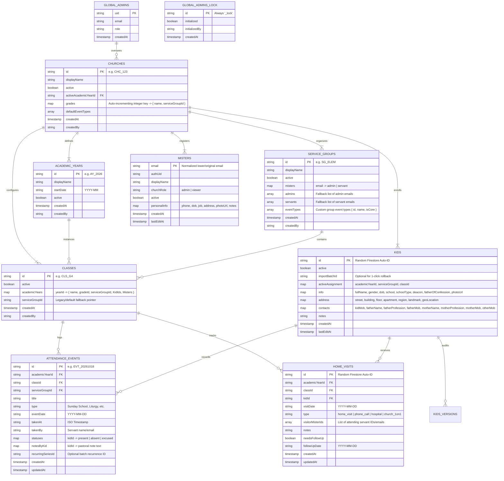
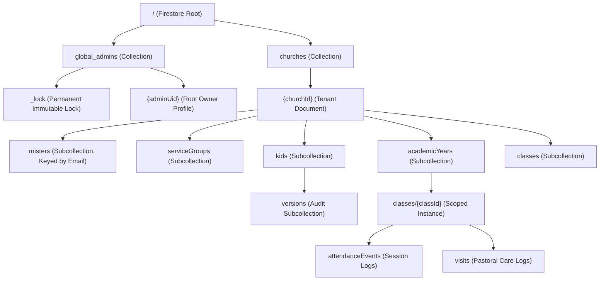
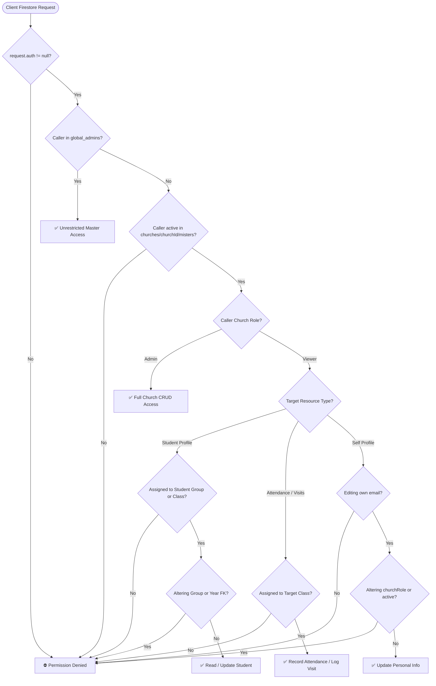

# Oikonomos: Firestore Database Schema & Relational Design

Oikonomos uses a modern, hierarchical, multi-tenant database architecture inside **Google Cloud Firestore**. 

The architecture is organized into three distinct tiers:
1.  **Global Layer (`global_admins`):** System-wide Day-0 bootstrap lock and super-user root authorizations.
2.  **Tenant Layer (`churches`):** Scoped church databases isolating tenant records, servant profiles, student CRM directories, and ministry departments.
3.  **Scoped Academic Layer (`academicYears` / `classes`):** Term-specific class rosters, student active assignments, home visitation logs, and attendance session events.

---

## 🗺️ Entity-Relationship Diagram (ERD)

---

## 🏛️ Multi-Tenant Hierarchical Path Topology

---

## 🛡️ Security & Role-Based Access Control (RBAC)

Oikonomos enforces multi-tenant zero-trust security at the Cloud Firestore database layer (`firestore.rules`). Client-supplied queries are strictly evaluated against authenticated session tokens and verified servant records.

### RBAC Permission Matrix

| Database Entity / Path | Global Admin | Church Admin | Group Admin | Group Servant | Class Servant | Viewer / Unassigned |
| :--- | :---: | :---: | :---: | :---: | :---: | :---: |
| **`/global_admins/_lock`** | Read (Create once) | Read Only | Read Only | Read Only | Read Only | Read Only |
| **`/global_admins/{adminId}`** | Read / Write | No Access | No Access | No Access | No Access | No Access |
| **`/churches/{churchId}`** | Full CRUD | Full CRUD | Read Only | Read Only | Read Only | Read Only |
| **`.../academicYears/{yearId}`** | Full CRUD | Full CRUD | Read Only | Read Only | Read Only | Read Only |
| **`.../misters/{misterEmail}`** | Full CRUD | Full CRUD | Read Only | Read Only | Self-Profile Only* | Self-Profile Only* |
| **`.../serviceGroups/{groupId}`**| Full CRUD | Full CRUD | Full CRUD** | Read Only | Read Only | Read Only |
| **`.../classes/{classId}`** | Full CRUD | Full CRUD | Full CRUD** | Read Only | Read Only | No Access |
| **`.../kids/{kidId}`** | Full CRUD | Full CRUD | Full CRUD** | Read Only** | Read / Edit (Class)* | No Access |
| **`.../kids/{kidId}/versions`** | Full CRUD | Full CRUD | Read Only** | Read Only** | Read Only** | No Access |
| **`.../attendanceEvents/{id}`** | Full CRUD | Full CRUD | Full CRUD** | Full CRUD** | Full CRUD (Class)** | No Access |
| **`.../visits/{visitId}`** | Full CRUD | Full CRUD | Full CRUD** | Full CRUD** | Full CRUD (Class)** | No Access |

*\* **Self-Service Lock:** Servants editing their own profile can modify personal information (`personalInfo`, `displayName`, `lastEditAt`, `lastEditBy`), but are strictly blocked from changing administrative fields (`churchRole`, `active`).*  
*\*\* **Division & Classroom Scoping:** Group-level and class-level roles are strictly scoped to resources matching the user's active assignment. Class servants updating a kid document can edit personal and contact fields, but are permanently locked from modifying `activeAssignment.serviceGroupId` or `academicYearId`.*

---

## 🔒 Security Invariant Decision Flow

---

## 📂 Detailed Collection Specifications

### 1. `churches/{churchId}/kids`
*   **Document ID:** Auto-generated 20-character alphanumeric ID (`doc(collection(...))`).
*   **Schema:**
    *   `active` (`boolean`, required): Active status indicator. Inactive kids are archived and hidden from active attendance sheets.
    *   `importBatchId` (`string`, optional): UUID tag linking all records created during a specific spreadsheet import for 1-click batch rollbacks.
    *   `activeAssignment` (`map`, required):
        *   `academicYearId` (`string`): Foreign key to the active term.
        *   `serviceGroupId` (`string`): Foreign key to the department.
        *   `classId` (`string`): Foreign key to the enrolled classroom.
    *   `info` (`map`, required):
        *   `fullName` (`string`): Full student name.
        *   `gender` (`'male' | 'female'`): Student gender.
        *   `dob` (`string`): ISO `YYYY-MM-DD` date of birth.
        *   `school` (`string`): Name of academic school.
        *   `schoolType` (`string`): `'National' | 'International' | custom`.
        *   `deacon` (`boolean`): Ordained altar deacon status.
        *   `fatherOfConfession` (`string`): Name of Father of Confession.
        *   `photoUrl` (`string`): Base64-encoded compressed WebP avatar ($128\times 128$ px, $<6$ KB).
    *   `address` (`map`, optional):
        *   `street`, `building`, `floor`, `apartment`, `region`, `landmark` (`string`).
        *   `geoLocation` (`string`): Standard `geo:lat,lng` URI or universal map coordinate string.
    *   `contacts` (`map`, optional):
        *   `kidMob`, `fatherMob`, `motherMob`, `otherMob` (`string`): Normalized E.164 phone numbers.
        *   `fatherName`, `fatherProfession`, `motherName`, `motherProfession` (`string`).
    *   `notes` (`string`): Multiline pastoral care remarks.
    *   `createdAt`, `lastEditAt` (`string`): ISO 8601 audit timestamps.
    *   `createdBy`, `lastEditBy` (`string`): Author email addresses.

---

### 2. `churches/{churchId}/misters`
*   **Document ID:** Verified Google Account Email address (e.g. `servant.john@gmail.com`).
*   **Schema:**
    *   `authUid` (`string`): Firebase Auth User UID.
    *   `email` (`string`): Google account email.
    *   `displayName` (`string`): Full legal/church name of the servant.
    *   `churchRole` (`'admin' | 'viewer'`): Branch authorization level.
    *   `active` (`boolean`): Active service status.
    *   `personalInfo` (`map`):
        *   `phone` (`string`): Contact mobile number in E.164.
        *   `dob` (`string`): ISO `YYYY-MM-DD` birthdate.
        *   `job` (`string`): Secular profession.
        *   `address` (`string`): Residential address.
        *   `gender` (`'male' | 'female'`).
        *   `notes` (`string`): Administrative remarks.
        *   `photoUrl` (`string`): Base64 compressed WebP photo.
    *   `createdAt`, `lastEditAt` (`string`): Audit timestamps.

---

### 3. `churches/{churchId}/classes`
*   **Document ID:** Semantic or auto-generated ID (e.g. `grade_4_st_george`).
*   **Schema:**
    *   `active` (`boolean`): Active classroom toggle.
    *   `academicYears` (`map`): Multi-term instance map:
        *   `{yearId}` (`map`):
            *   `name` (`string`): Localized class title for this term.
            *   `gradeId` (`string`): Foreign key to the church's `grades` taxonomy.
            *   `serviceGroupId` (`string`): Foreign key to the parent Service Group.
            *   `KidIds` (`array of strings`): Enrolled student IDs array.
            *   `Misters` (`map`): Assigned servant roles (`{ [email]: 'servant' }`).
            *   `MistersIds` (`array of strings`): Fast array search index of servant emails.

---

### 4. `academicYears/{yearId}/classes/{classId}/attendanceEvents`
*   **Document ID:** Unique event ID (e.g. `evt_20261018_lesson1`).
*   **Schema:**
    *   `title` (`string`): Session name (e.g. `David and Goliath`).
    *   `type` (`string`): Ministry event category (`Sunday School`, `Liturgy`, `Trip`, etc.).
    *   `eventDate` (`string`): Strict `YYYY-MM-DD` session date.
    *   `takenAt` (`string | null`): Timestamp when roll-call was finalized.
    *   `takenBy` (`string | null`): Servant name/email who completed roll-call.
    *   `statuses` (`map`): Dynamic student status map (`{ [kidId]: 'present' | 'absent' | 'excused' }`).
    *   `notesByKid` (`map`): Per-student pastoral follow-up notes (`{ [kidId]: string }`).
    *   `recurringSeriesId` (`string`, optional): Links sessions generated via recurring schedule.

---

### 5. `academicYears/{yearId}/classes/{classId}/visits`
*   **Document ID:** Auto-generated visit UUID.
*   **Schema:**
    *   `kidId` (`string`): Foreign key to target student in `kids`.
    *   `visitDate` (`string`): Strict `YYYY-MM-DD` visitation date.
    *   `type` (`'home_visit' | 'phone_call' | 'hospital' | 'church_1on1'`): Interaction mode.
    *   `visitorMisterIds` (`array of strings`): Array of participating servant IDs.
    *   `notes` (`string`): Pastoral discussion minutes and prayer requests.
    *   `needsFollowUp` (`boolean`): Flag marking this case for subsequent review.
    *   `followUpDate` (`string`, optional): Target follow-up date.
