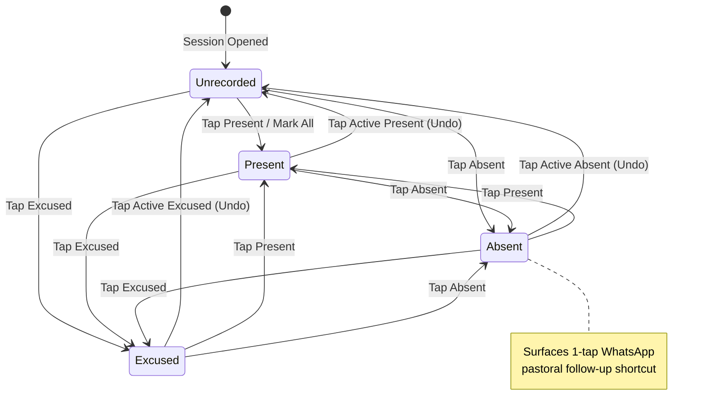
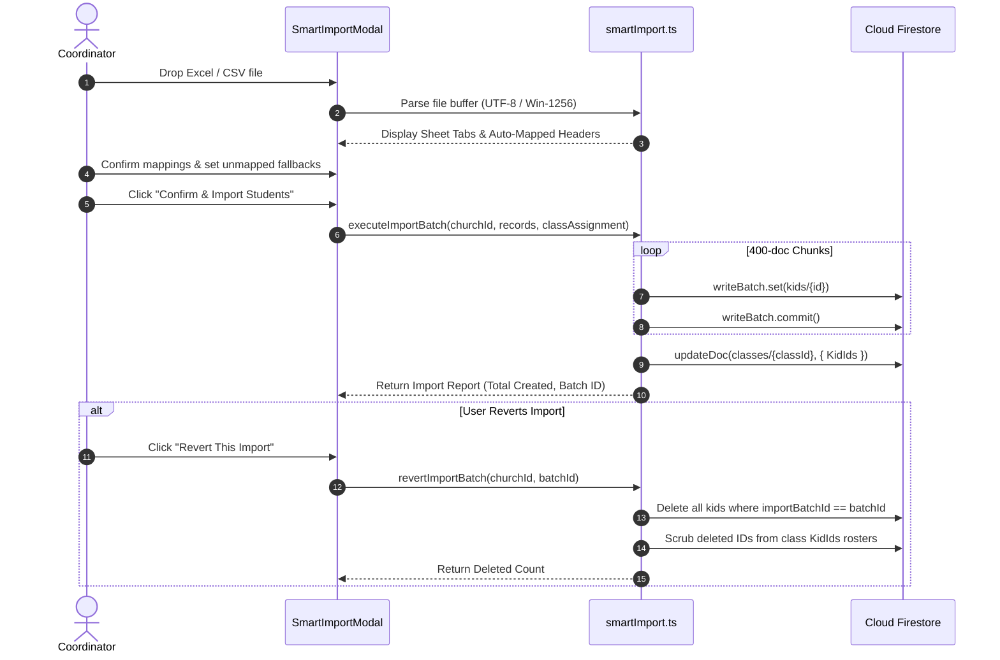
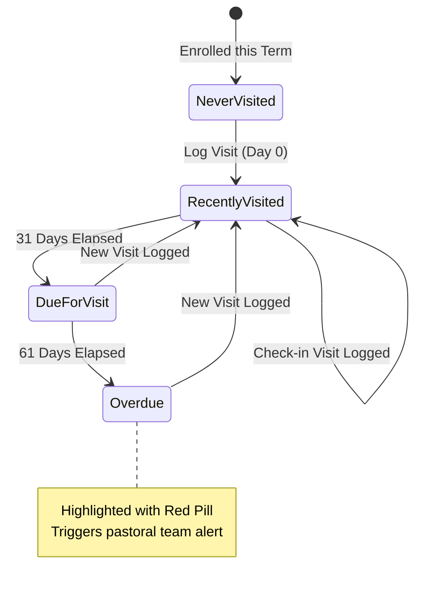

# Oikonomos: Core User Scenarios & Pastoral Workflows

This document defines the high-signal user stories, real-world operational workflows, and state machines for **Oikonomos (Sunday School Admin & CRM)**.

---

## 👥 Core Personas

### 1. The Sunday School Coordinator (Overall Administrator / Group Admin)
*   **Mission:** Ensures operational excellence, accurate rosters, and pastoral accountability across departments.
*   **Key Responsibilities:** Onboarding students, servant management, classroom structuring, bulk promotions, and term transitions.

### 2. The Sunday School Servant (Pastoral Teacher / Class Mister)
*   **Mission:** Delivers spiritual lessons, monitors weekly attendance, and conducts personal pastoral follow-ups.
*   **Key Responsibilities:** Weekly roll-call, contacting absentees via WhatsApp, navigating to homes, and logging pastoral care visits.

---

## 📋 Comprehensive User Workflows & State Machines

### 🎯 Scenario 1: Sunday Morning 10-Second Roll-Call & Absentee Outreach
> **As a** Sunday School Teacher,  
> **I want to** quickly take roll call on my phone with minimal taps and immediately follow up with absentees via WhatsApp,  
> **So that** roll call takes under 10 seconds and absent children receive immediate pastoral care.

#### Workflow Sequence
1.  **Open Attendance:** The teacher taps **Attendance Tracker** on their smartphone. The view automatically scrolls and focuses on today's active session on the timeline ribbon.
2.  **Mark All Present:** The teacher taps **"⚡ Mark All Present"**. All enrolled students immediately transition to `Present` ($✓$).
3.  **Toggle Absentees:** The teacher taps the two absent students to mark them `Absent` ($✕$).
4.  **Instant WhatsApp Outreach:** An instant green **WhatsApp** button appears on the absent student's card. Tapping it opens WhatsApp with a pre-composed personalized message to the father:
    > *"سلام ونعمة يا أستاذ رامي، بنفتقد جداً إدريان في مدارس الأحد، لعله بخير ومستنينه الأسبوع الجاي بنعمة ربنا!"*
5.  **Background Auto-Save:** Attendance persists to Firestore in the background via debounced commit (900ms), displaying `✓ Saved to cloud`.

#### Attendance 4-State Machine Diagram

---

### 🎯 Scenario 2: Smart Spreadsheet Onboarding with 1-Click Rollback
> **As a** Coordinator,  
> **I want to** import an existing Excel/CSV student register with Arabic headers and verify mappings before committing,  
> **So that** hundreds of students are onboarded in seconds with zero data corruption.

#### Workflow Sequence
1.  **File Drop & Encoding Auto-Detection:** The coordinator uploads an Excel or CSV file. The engine auto-detects encoding (UTF-8 vs. `windows-1256` Arabic ANSI), eliminating character garbling.
2.  **Sheet Selection & Header Scanning:** For multi-sheet workbooks, the user selects the target tab. The engine automatically bypasses title rows and locates the true header row.
3.  **Heuristic Field Mapping:** The engine matches bilingual columns (`اسم المخدوم بالكامل` $\to$ `fullName`, `موبايل ولي الأمر` $\to$ `fatherMob`, `تاريخ الميلاد` $\to$ `dob`).
4.  **Unified Unmapped Fallbacks:** For columns missing from the sheet (e.g. `gender` or `schoolType`), the coordinator selects a batch fallback (e.g. *"All Male"* or *"Auto-Detect from School Name"*).
5.  **Atomic Batch Import:** Student documents are created with a shared `importBatchId` and automatically enrolled into the target classroom.
6.  **1-Click Rollback Safety:** If the wrong file was imported, clicking **"Revert This Import"** in the completion report atomically deletes all imported students and cleans the classroom roster.

#### Smart Import & Rollback Sequence Diagram

---

### 🎯 Scenario 3: Pastoral Care Home Visits & Universal GPS Navigation
> **As a** Sunday School Servant,  
> **I want to** navigate to a student's home using GPS coordinates and log visitation minutes,  
> **So that** our pastoral care history is organized and overdue students are flagged.

#### Workflow Sequence
1.  **Identify Overdue Students:** The servant navigates to **Home Visits**. The dashboard highlights students with red badges (`Overdue (>60d)`) who haven't had a visit in two months.
2.  **Turn-by-Turn GPS Navigation:** The servant taps **"🚗 Navigate"** on the student's card.
    *   On an **iPhone**, it natively opens **Apple Maps** with driving directions (`maps.apple.com/?daddr=...`).
    *   On an **Android phone or PC**, it opens **Google Maps** (`google.com/maps/dir/?api=1&destination=...`).
3.  **On-Site GPS Pinning:** If coordinates were missing, standing at the door allows the servant to tap **"📍 Pin Home Location"**, saving device GPS coordinates directly into Firestore.
4.  **Log Pastoral Visit:** Tapping **"Log Visit"** opens a modal pre-filled with today's date. The servant selects participating co-servants, records family prayer requests, flags follow-up if needed, and saves.
5.  **Pastoral Health Indicator Updates:** The student's status pill immediately updates from `Overdue` to `Recently Visited` ($✓$).

#### Home Visits Health State Transition

---

### 🎯 Scenario 4: Google Contacts Cloud Synchronization
> **As a** Servant,  
> **I want to** sync my Sunday School students and their parents to my personal phone address book via Google Contacts,  
> **So that** incoming parent calls display the child's name in Caller ID and I can message them directly on WhatsApp without manual typing.

#### Workflow Sequence
1.  **Initiate Sync:** The servant opens **Kids Directory** and clicks **"Sync to Google Contacts"**.
2.  **OAuth Consent:** The browser prompts for Google Contacts permission (`https://www.googleapis.com/auth/contacts`). The access token is stored safely in ephemeral `sessionStorage`.
3.  **Contact Label Creation:** The sync engine creates a Google Contact Label: `[Oikonomos] St. Mark - Grade 4 (2026)`.
4.  **Contact Deduplication & Creation:** Each student is created as `[SS] <Student Name>` with father and mother mobile numbers formatted in E.164 (`+20...`) and home address populated.
5.  **Avatar Sync:** If the student has a compressed WebP profile picture in Firestore, the image is uploaded directly to their Google Contact photo.
6.  **Results:** Opening the native Phone dialer or WhatsApp on the servant's phone immediately recognizes parent numbers with student names.

---

### 🎯 Scenario 5: Multi-Select Bulk Classroom Reassignment & Promotion
> **As a** Coordinator,  
> **I want to** select 40 students in the directory and move them to a new class in one action,  
> **So that** start-of-year class assignments are atomic and leave no duplicate enrollments.

#### Workflow Sequence
1.  **Filter & Multi-Select:** The coordinator filters the directory by `Grade 4`. They check the master checkbox to select all 40 students.
2.  **Bulk Action Bar:** A floating bar appears at the bottom showing: *"40 students selected"*. The user clicks **"Reassign Class"**.
3.  **Target Selection:** A modal prompts for Target Year, Service Group, and Class (e.g. `Grade 5 St. George`).
4.  **Atomic Reconciliation:**
    *   Firestore batch updates all 40 student documents (`activeAssignment.classId = targetClassId`).
    *   The target class document appends the 40 student IDs to its `KidIds` array.
    *   The origin class documents atomically prune those 40 student IDs from their rosters.
5.  **Confirmation:** The directory table re-renders with updated assignment chips, and student counts across both classes reflect the transfer accurately.
